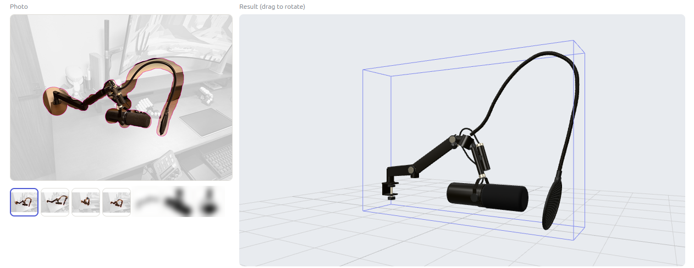
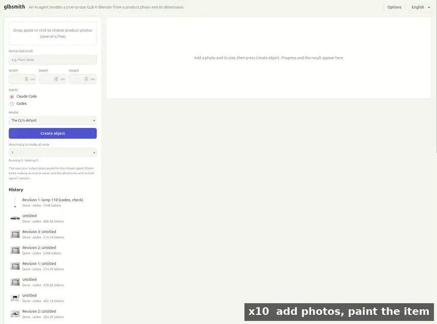

# glbsmith

Turn a product photo and its dimensions into a true-to-size GLB. A local AI agent (Claude Code or Codex, using your own subscription) models the item part by part in Blender, compares renders with the photo, and fixes what is off.



<sub>Paint what you want on a photo, and get a true-to-size 3D model. Left: the photo, with everything but the painted item faded. Right: the model. The blue box is the size you entered. The product photos in the small row are blurred here.</sub>

Image-to-3D generators can stretch a model to the right outer size, but they often lose what is inside that box. An agent can see that a floor lamp has a big shade, a thin stem and a small base, and build each part on purpose.

It can also build several things that are used together as one model:



<sub>The video is sped up: ×10 while adding photos and painting, ×20 while the agent works, and ×2 for the result. The product photos in the list are blurred here.</sub>

What happens between pressing **Create object** and the model appearing:

1. **Read the photos.** The agent looks at all of them, works out the camera angle and writes a table of every part with its size and position.
2. **Model.** It builds each part in Blender with Python: tubes as curves, holes as real holes, each part with its own name and material.
3. **Look from all sides.** It renders the front, side, top and an angled view, and fixes what it finds.
4. **Lay it over the photo.** `check_against_photo` overlays the model on the photo in the same view and compares widths from top to bottom. The agent fixes what is flagged and checks again.
5. **Measure and write the file.** glbsmith measures the model itself, checks it against the size you entered, writes the GLB and reads it back to confirm.
6. **Your turn.** The result opens in a 3D viewer next to the photo. Anything that isn't right can be painted and changed.

One photo is enough to start. Photos from different angles help up to a point, because the agent sees sides and shapes that one view hides, which is why this run has several similar-looking shots of the same desk. That is experience so far, not a measurement: a benchmark of how photo count affects quality is planned.

This run used seven photos, four of them painted, and made a model of 74 parts, 72.3 × 14.7 × 50 cm, in about 7 minutes and 820,000 tokens with Codex. Its overlay check stayed below the pass line (0.45 against 0.6), so the file was written with a warning on the page, which you can read at the end of the video: on a busy photo, paint that goes over the edges counts as part of the outline.

| Works well | Works less well |
|---|---|
| Lamps, shelves, tables, chair frames, PC cases, desk gear: clear parts, thin members, real gaps, several items in one | Plush toys, wrinkled fabric, intricate carving, photo-exact patterns |

Sides that the photo does not show are still guesses.

## Quick start

Requirements: Linux, [uv](https://docs.astral.sh/uv/), Node.js 22+, [Blender](https://www.blender.org/download/) 5.2 LTS, and the `claude` or `codex` CLI, signed in with your own account or used with your own API key.

```bash
uv sync
npm ci && npm run build
export BLENDER_BIN=/path/to/blender    # or unpack Blender so .tools/blender/blender exists
uv run python -m glbsmith.app          # http://127.0.0.1:8021
```

Add one or more photos, enter the width, depth and height, choose an agent and press **Create object**. Progress and renders appear as the agent works; the finished model appears in a 3D viewer next to the photo, with a download button.

- **Several photos** (up to 8): one is enough, and more angles improve the result up to a point. The agent uses them all to understand the sides and construction. The first is the main one: it sets the proportions and must pass the check against the photo. Use **Make main** to change it.
- **Paint the item**: if a photo also shows other products, props or a busy background, press the button under it and paint what you want made. The agent is told to ignore the rest, and the check uses your paint as the outline, so busy photos can be measured too. On a plain background, a rough stroke is trimmed to the item's edge.
- **How many to make at once**: jobs beyond this number wait in the queue. Changes apply straight away, and running jobs are never stopped. Rendering threads are shared between jobs, but quota is used up faster.

**Options** lets you add an API key. An agent then also appears as **Claude Code (API)** or **Codex (API)**, billed per use on that key. The plain choices keep using your subscription and never get the key. A key exported as `ANTHROPIC_API_KEY` or `OPENAI_API_KEY` counts too.

To try the whole flow without using any quota, run the server with `GLBSMITH_FAKE_AGENT=1` and choose **Fake**. It builds two boxes.

You can also run a job from the command line:

```bash
uv run python -m glbsmith.run photo.png [more.png ...] --width 35 --depth 35 --height 155 --agent claude
```

## Use it from any AI agent (MCP)

glbsmith is also an MCP server. An agent that can read images from tools, such as Claude Code, Codex or Claude Desktop, can then make models itself: nothing else is launched, so it uses that agent's own plan, and the web app doesn't need to be running.

```bash
claude mcp add glbsmith -- uv run -q --directory /path/to/glbsmith python -m glbsmith.mcp_server
codex mcp add glbsmith -- uv run -q --directory /path/to/glbsmith python -m glbsmith.mcp_server
```

For Claude Desktop, add this to its config:

```json
{ "mcpServers": { "glbsmith": { "command": "uv", "args": ["run", "-q", "--directory", "/path/to/glbsmith", "python", "-m", "glbsmith.mcp_server"] } } }
```

Then ask for what you want: "Make a 3D model of the lamp in ~/photos/lamp.jpg. It's 130 cm tall."

| Tool | What it does |
|---|---|
| `start_model` | Starts a model from photo files and a size, and returns the steps to follow |
| `get_brief`, `run_python`, `measure`, `render_views`, `check_against_photo`, `bake_materials` | The same work the web app's agents do, with the same sandbox |
| `finalize` | Applies the same size and photo checks, writes the GLB and returns its path |
| `revise_model` | Changes a finished model from an instruction, keeping the original |
| `list_models` | Lists the models made so far and where each GLB is |

Models appear in the web app's history too, so you can look at them in 3D, or paint changes on them. Set `BLENDER_BIN` in the server's environment if Blender isn't in `.tools/blender`, and `GLBSMITH_JOBS` to keep the models somewhere else.

## Making changes

When a model is close but not right, press **Make changes** on the result. Paint on the model in 3D with up to five colours, write an instruction for each ("make this longer", "add a peg here so it fits into the desk"), and press **Start changes**. You can also add an instruction about the whole model. Any instruction can have as many images attached as you like, by pasting, dropping or the button, to show what you mean. Each one adds to the tokens used.

The agent reopens the same Blender scene and is told to change only what was asked. It gets the paint as exact positions, the parts it landed on, and pictures of it. The result is a new entry in the history, and the original stays as it was, so you can go back or try something else.

A revision follows your instructions rather than the original size and photo: parts may go beyond the original box, and the check against the photo is optional. The file is written at the size it was built.

## What the GLB guarantees

The size you enter is the **box the item must fit in**, and the photo decides the proportions. `finalize` measures the model itself rather than trusting the agent:

- The model fits inside the box and touches it on at least one axis. Within 2% is corrected; beyond that the file is refused and the agent has to fix the model. The written file is read back and checked again.
- Axes that come out smaller than the box are shown as a warning on the page, because it usually means the size you entered doesn't match the photo.
- 1 unit = 1 metre, +Y up, front facing +Z, origin at the centre of the base.
- Each part is a separately named mesh with PBR materials.

Any app that follows these conventions can use the file. In [Room Setup](https://github.com/maromocooo/room-setup), use **Import GLB**.

## Checking against the photo

Before writing the file, the agent has to run `check_against_photo`, the reference-image check 3D artists do by hand. It finds the view that lines the model up with the photo, overlays them, and compares their widths band by band from top to bottom. A base drawn three times too wide shows up as a flagged band, which the agent then fixes. After three failed checks the file is written anyway, with a warning on the page.

Limits: it compares outlines one view at a time, so it can't check details inside the outline, and it can't tell a box's front from its back. Those are left to the agent's eye and yours. A main photo with a busy background can't be measured unless you paint the item; the page says so.

## How it works

```
Browser ──> FastAPI (localhost) ──> claude -p / codex exec
                                         │ MCP (stdio)
                                    glbsmith.mcp_server ──> blender --background
```

The agent gets eight tools and nothing else: `get_brief`, `get_revision_requests`, `run_python`, `render_views`, `measure`, `check_against_photo`, `bake_materials` and `finalize`. See [prompts/modeler.md](prompts/modeler.md) and [prompts/reviser.md](prompts/reviser.md) for its instructions.

## Security and privacy

`run_python` runs code that an AI wrote, and text inside a photo could try to steer that AI. So:

- The Blender process locks itself down with [Landlock](https://docs.kernel.org/userspace-api/landlock.html) before running any of that code. It can read Blender and system libraries, can write only to the job folder, and has no TCP access. It receives none of your environment variables. An audit hook also refuses UDP sockets and new processes from Python, but that hook is a speed bump, not a wall: determined code using `ctypes` could still send UDP.
- If Landlock is not available, the app says so and asks for your explicit consent before running.
- The agents run without shell or file tools, and without your settings, hooks or other MCP servers.
- The server binds to localhost and refuses other sites and hostnames. It has no authentication, so do not expose it to a network.
- The photos are sent to the service of the agent you choose. EXIF data such as GPS position is removed first. Painting fades the rest of a photo but does not remove it, so anything in the frame still goes along. Crop out what should not be sent.
- API keys are saved in plain text in `~/.config/glbsmith/keys.json`, readable only by you, and never sent back to the page. A key reaches only the agent you chose as "(API)", through its environment, and never reaches Blender. Subscription choices run without any key, so a job cannot silently switch to pay-per-use billing.

## Using your subscription

glbsmith runs the official, unmodified `claude` and `codex` programs on your own computer, signed in with your own account. It never sees or stores your login, and it isn't a hosted service. Your use of those programs stays under your own agreement with their makers, so check their terms yourself:

- Anthropic: [Claude Code legal and compliance](https://code.claude.com/docs/en/legal-and-compliance). Plan limits assume ordinary, individual use, and developers building products are directed to API keys.
- OpenAI: [Codex authentication](https://learn.chatgpt.com/docs/auth). API keys are the recommended default for automation.

If you're unsure, or you run many jobs at once, use an API key through **Options**. Don't offer glbsmith to other people as a service on your own login.

glbsmith is an independent project, not affiliated with or endorsed by Anthropic or OpenAI. Claude and Claude Code are trademarks of Anthropic; Codex and ChatGPT are trademarks of OpenAI.

## Images and licences

Use photos you have the right to use. A model made from someone else's product photo is best kept to personal use, such as planning your own room.

glbsmith is [MIT](LICENSE) licensed. Blender is GPL and is not included.

## Tests

```bash
uv run pytest                # real Blender and the fake agent; uses no quota
GLBSMITH_FAKE_AGENT=1 GLBSMITH_JOBS=$(mktemp -d) uv run python -m glbsmith.app &
npm run test:ui
```
